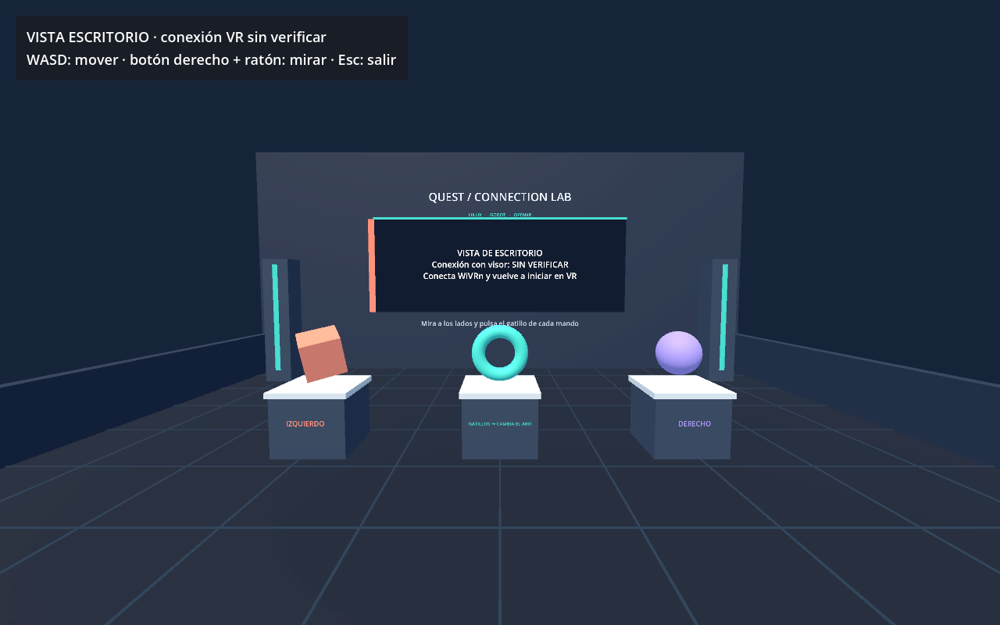

# Prueba independiente · Quest 3S + Linux

Proyecto Godot 4.6 Standard separado del juego principal. Contiene un laboratorio de 10 × 10 metros, cuadrícula de un metro, tres objetos, un aro animado, mandos visibles y un panel de diagnóstico en el entorno. No carga escenas, reglas ni partidas del juego.



## Ver el entorno en el PC

Desde la raíz del repositorio:

```bash
bash Pruebas/ConexionQuest/iniciar.sh --desktop
```

WASD mueve la cámara; mantén botón derecho y mueve el ratón para mirar. Esc cierra la prueba. Esta vista permite revisar el escenario y siempre indica que la conexión VR está **sin verificar**.

También puedes importar `project.godot` en Godot y ejecutar la escena. La carpeta puede copiarse a otro equipo; requiere Godot instalado allí o `GODOT_BIN` con su ubicación.

## Verlo dentro de los Quest

1. Abre `wivrn-dashboard`, instala su cliente en el visor y comprueba que cliente y servidor tienen la misma versión.
2. Para USB, activa modo desarrollador, conecta un cable de datos y acepta la depuración USB dentro del visor. Comprueba que `adb devices -l` muestra `device`.
3. Desde la raíz del repositorio, abre WiVRn por el cable:

```bash
bash scripts/connect-quest-usb.sh
```

4. Completa el emparejamiento y espera a que el dashboard indique que los Quest están conectados. Para Wi-Fi, conéctalos desde la aplicación WiVRn del visor a tu PC en la misma red.
5. Inicia **esta prueba**, con el siguiente comando:

```bash
bash Pruebas/ConexionQuest/iniciar.sh
```

Ponte el visor, cierra el menú del sistema, mira a ambos lados y pulsa el gatillo de cada mando. Cada pulsación cambia el color y tamaño del aro central. El panel se vuelve verde cuando recibe tracking de cabeza, movimiento, tracking de ambos mandos y gatillos de ambos lados en una sesión OpenXR enfocada.

El estado verde confirma los datos que recibe la aplicación. Comprueba además que ves el entorno correctamente en **ambos ojos**. La prueba no mide la calidad de la transmisión, la latencia ni el rendimiento del juego principal. La cámara VR sigue el visor y no se mueve automáticamente.

## Si no entra en VR

- **Vista de escritorio:** OpenXR no se inicializó. Conecta primero el visor en WiVRn y vuelve a ejecutar la prueba.
- **Sesión en espera:** ponte el visor, vuelve a la aplicación y cierra el menú del sistema.
- **Mando pendiente:** enciende los dos mandos Touch y mantenlos visibles para el visor; esta prueba usa mandos, no manos sin controladores.
- **Error de encoder/NVENC:** corrige la codificación en WiVRn antes de probar la escena. En el equipo revisado la RTX 3070 usa nouveau/NVK y falta el controlador NVIDIA que proporciona NVENC. La alternativa por CPU se describe abajo.

## Primera prueba con codificación por CPU

El paquete Fedora 26.9 de este equipo no incluye x264. Se instaló WiVRn 26.9 de Flathub para disponer de ese encoder. [La distribución de Flathub incluye x264](https://github.com/flathub/io.github.wivrn.wivrn/blob/master/io.github.wivrn.wivrn.yml).

Con cualquier otro servidor WiVRn cerrado, ejecuta desde la raíz del repositorio:

```bash
flatpak run \
  --filesystem="$PWD/Pruebas/ConexionQuest:ro" \
  --command=wivrn-server io.github.wivrn.wivrn \
  -f "$PWD/Pruebas/ConexionQuest/wivrn-cpu.json"
```

Este servidor usa la configuración de prueba `wivrn-cpu.json`, con x264 y H.264. Mantén esa terminal abierta; no abras además el dashboard nativo. Cliente y servidor deben tener la misma versión.

Abre WiVRn dentro de los Quest y conecta al PC en la misma red. Para USB siguen siendo necesarios modo desarrollador, autorización ADB y `scripts/connect-quest-usb.sh`. Si el visor aún no está emparejado con este servidor, ejecuta `wivrnctl pair -d 5` en otra terminal y completa el emparejamiento.

Cuando aparezca el lanzador de aplicaciones dentro del visor, inicia la escena con `bash Pruebas/ConexionQuest/iniciar.sh`. La codificación por CPU sirve para la prueba de conexión; puede limitar la fluidez. Si ocurre, reduce resolución y bitrate en WiVRn. Para evaluar el juego con NVENC queda pendiente instalar el controlador NVIDIA adecuado.

En este equipo se comprobó que el servidor establece la sesión con x264 y que Godot 4.6.3 inicia el laboratorio en OpenXR con WiVRn 26.9 y Vulkan/Mobile en la RTX 3070. Esto acredita el arranque en VR. La imagen en ambos ojos y la validación de tracking y gatillos siguen pendientes de la prueba dentro del visor.

Esta prueba usa **Mobile/Vulkan**, según la recomendación de Godot para XR. Puedes probar OpenGL temporalmente, sin editar el proyecto:

```bash
bash Pruebas/ConexionQuest/iniciar.sh --rendering-method gl_compatibility --rendering-driver opengl3
```

Para otro ejecutable del motor:

```bash
GODOT_BIN="/ruta/Godot" bash Pruebas/ConexionQuest/iniciar.sh
```

Consulta [la guía de conexión del equipo](../../Godot/docs/LINUX_QUEST_WIVRN.md), [WiVRn](https://github.com/WiVRn/WiVRn#usage) y [OpenXR en Godot](https://docs.godotengine.org/en/4.6/tutorials/xr/setting_up_xr.html).
